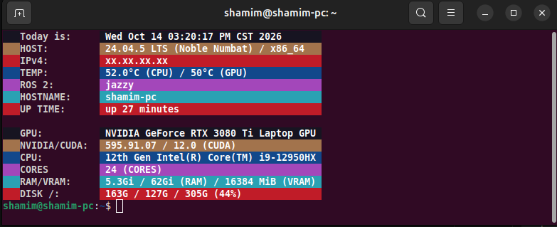

<div align="center">



<h1 align="center" >


<b>Terminal Configuration</b>


</h1>

[](https://github.com/vividblueprint)
[](https://github.com/vividblueprint/myconfig/issues)
[](https://github.com/vividblueprint/myconfig/pulls)
[](https://github.com/vividblueprint/myconfig/graphs/contributors)
[](https://github.com/vividblueprint/myconfig/stargazers)
[](https://github.com/vividblueprint/myconfig/forks)
[](https://github.com/vividblueprint/myconfig/watchers)
[](https://github.com/vividblueprint/myconfig/commits)
[](https://github.com/vividblueprint/myconfig/commits)
[](https://github.com/vividblueprint/myconfig)
[](https://github.com/vividblueprint/myconfig)
[](https://github.com/vividblueprint/myconfig)
[](https://github.com/vividblueprint/myconfig/commits)
[](https://github.com/vividblueprint/myconfig/tree/HEAD)
[](https://github.com/vividblueprint/myconfig/blob/HEAD/LICENSE)

</div>

---

## Introduction

Personal Linux configuration and development environment scripts. This repository contains Bash configuration files, aliases, environment variables, and helper scripts for my robotics and development workstation.

## Structure

| File | Purpose |
|------|---------|
| `bash.bash` | Bash configuration and shell settings |
| `conda.bash` | Conda environment configuration and shortcuts |
| `cp.bash` | Competitive programming environment |
| `docker.bash` | Docker configuration and aliases |
| `esp32.bash` | ESP32 / PlatformIO environment |
| `ethercat.bash` | EtherCAT configuration |
| `git.bash` | Git aliases and configuration |
| `info.bash` | System and hardware information |
| `isaaclab.bash` | Isaac Lab environment and shortcuts |
| `monitor.bash` | Monitor/display configuration |
| `monokai.xml` | Monokai terminal/editor color scheme |
| `my.bash` | Main personal Bash configuration |
| `nvidia.bash` | NVIDIA / CUDA configuration |
| `robot.bash` | Robotics workspace configuration |
| `ros.bash` | ROS / ROS 2 environment |
| `set.bash` | General environment variables and settings |
| `ssd.bash` | SSD / storage utilities |
| `system.bash` | System configuration and utilities |
| `uv.bash` | uv / Python environment configuration |

## Installation

Clone the repository:

```bash
# Clone
git clone https://github.com/vividblueprint/myconfig.git ~/playground/myconfig

# Set Bash
bash ~/myconfig/set.bash
```
